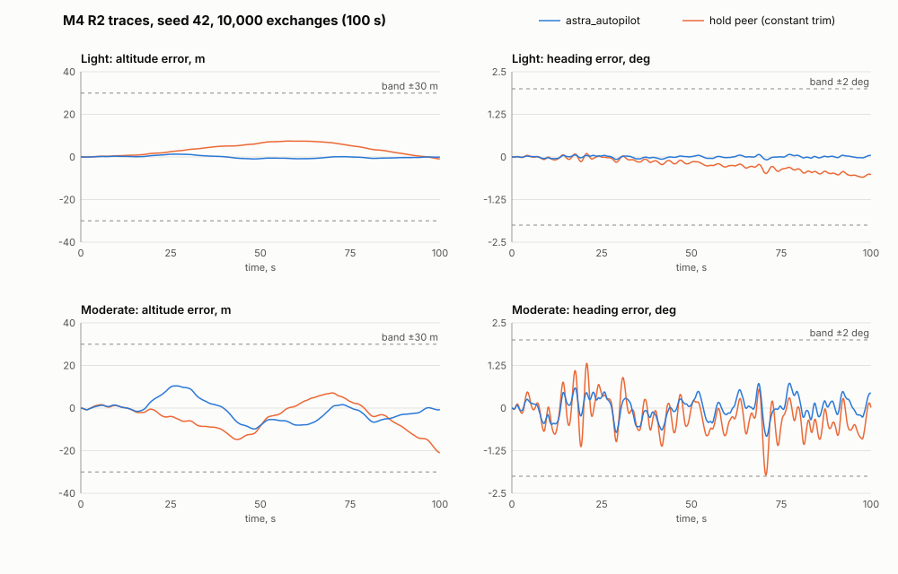
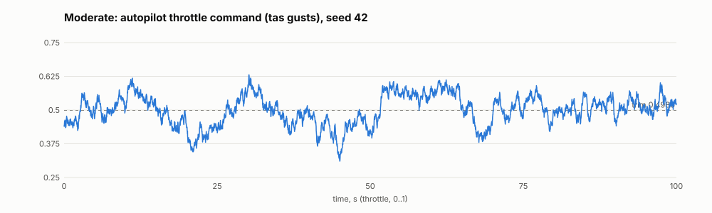

# Human review packet: M4 PR 6, turbulence configs, `astra.lockstep`, and the M4 acceptance runs

PR / candidate base and head: base `f4de27d` (`origin/main`, PR 5 #56's merge; re-fetched before this packet,
unmoved). **Candidate `4e418e1`** (product and tests) on branch `worktree-m4-pr6-lockstep-acceptance`; the head is
`9a1e761` plus this packet's commit, whose commits after `4e418e1` add evidence and records only. Commits since
`origin/main`:
- `bf8ca3b` plan revision 2; `e71305b` plan revision 3 (your approval, Q1 to Q4, E1 to E4 folded in);
- `7c7725d` implementation (round 0 candidate); `30611b5` its evidence;
- `dff89af` correction round 1 (R-001 to R-003); `4e418e1` **correction round 2** (tests only);
- `9a1e761` evidence for `4e418e1` and the review record.

The tree is clean. After Joe's approval (Decision record) the branch is pushed as a draft PR whose body is this
packet; Joe squash-merges.

Spec/plan/task: [PR 6 plan, revision 3](../plans/m4-pr6-lockstep-acceptance.md), **approved by Joe 2026-09-26**, under
the [M4 plan](../plans/m4-lockstep.md) PR 6 row, R1 to R4b, R12b, Q3, Q5, Q7, Q15, Q19, A6.
Risk: Tier 3 (transport lifecycle and cleanup; acceptance of the milestone). No `core/`, `icd/`, `embedded/`, HAL,
shm-layout, golden, tolerance-file or ADR change.
Decision requested (now decided, see Decision record): approve behavior for this PR (the M4 acceptance evidence and the driver); then you push as a draft
PR and squash-merge. No release requested. PLAN.md's M4 check-off is PR 7.

## What changes and why

**Before:** the pieces of M4 existed separately (core seam, shm transport and HAL, the autopilot), but nothing flew
the aircraft with the autopilot in the loop, no config carried a transport block, Python could not read the exchange
recorder, and no test proved R1 to R4b or R12b.

**After:**
- **Configs** `aircraft/notional_transport/configs/cruise_light_turbulence.yaml` and `cruise_moderate_turbulence.yaml`:
  `cruise.yaml` copied verbatim except `physical.wind` (seed 42; light `sigma_high` 0.15 m/s, `w20_knots` 15; moderate
  1.5 m/s, 30 kn; your Q7 chart read cited, plus the one-line note that `cruise.yaml`'s 3.0 m/s lies between 10^-4
  and SEVERE), `sim.frames` 100,000, and a `transport` block (shm, divisor 10, `timeout_ms` 1000,
  `handshake_timeout_ms` 5000, `peer_timeout_ms` 2000, the command map, limits equal to `limits.hpp`). No `segment`:
  the file alone is a `ConfigError` naming `transport.segment` (tested). `cruise.yaml` untouched.
- **Binding** (your Q2): `Simulation.exchange_recorder_bytes()` returns a copied `bytes`, or `None` without a
  transport. A lifecycle test holds the bytes past the session's end and the refcount check stays quiet.
- **`python/astra/lockstep.py`** (pyright strict):
  - segment naming `astra_<pid>_<16 hex>`, validated before anything is launched (R-001);
  - `load_config`, `trim_for`, and the argv builders; segment and timeouts come from the config, so the sim and the
    peer never disagree;
  - `PeerProcess`: a pidfd from launch for exact exit timing and liveness, and a bounded SIGCONT, SIGTERM, grace,
    SIGKILL, reap on every path (R-002);
  - `lockstep_session`: nested cleanup, the body's exception preserved with cleanup errors as notes, interrupts
    re-raised after every step, and a refcount check against a baseline taken after construction (E2);
  - `run_closed_loop`, `parse_recording`, and `remove_stale_segments`.
- **Tests:**
  - `tests/python/test_lockstep.py` has 42 tests; every lockstep run is in a `lockstep_child.py` process with a hard
    timeout, pytest is a child subreaper, and `lockstep_signaler.py` kills on notify and injects the jitter.
  - `tests/lockstep/closed_loop_acceptance_test.cpp` (ctest `ClosedLoopAcceptance`) has the limits-equality test, a
    1,000-exchange light run and a same-process R3 pair on all four presets, and the full 10,000-exchange light run
    on asan only, labelled `acceptance`.
- **Shared-file edits:** `cmake/AstraPlugin.cmake` (two new test targets added to the plugin build-order list),
  `tests/lockstep/CMakeLists.txt` (appended), `docs/process/validation.md` (two rows).

**Diff summary (excluding the evidence directory), `f4de27d..4e418e1`:** 13 files, 3619 insertions, 2 deletions (the
two deletions are the `AstraPlugin.cmake` list line and the binding's last `;`). About 2,000 of the lines are tests
and test support.

**Deviations from the plan text, for your eye:**
1. **`trim_for` trims a temporary copy without the `transport` block.** `astra.trim` builds a `Simulation` from the
   file; on a lockstep config that would demand a segment and wait for a peer. `astra.trim` itself is unchanged and
   still strips the wind. The trims equal `cruise.yaml`'s digits exactly (`test_trim_matches_config_initial_state`).
2. **Cleanup order when the body raised: the peer is stopped before the `Simulation` is dropped.** The plan's order
   (drop, then stop) let the sim, which itself had not failed, send `CLOSED`. The peer then exited 0 for a session the
   driver aborted. Found by the lifecycle tests before round 0. Normal completion keeps the plan's order (drop, then
   wait for exit 0).
3. **Test placement:**
   - The C++ short runs take the trim from the config rather than `astra.trim`, since there is no Python under
     asan; the pytest trim test links the two.
   - ctest raises the timeouts to 5000/10000 ms as a liveness bound under 32-way sanitizer load, not an accuracy
     tolerance.
   - The `test_simulation.py` binding test named in the plan lives in `test_lockstep.py`
     (`test_exchange_recorder_bytes_is_a_copy_and_none_without_transport`).
4. **R2d was implemented on the literal reading of your approval**, which kept the optional (c) line marked "delete
   if not wanted". It is one test (`test_r2d_autopilot_beats_hold_light`); delete it if you meant to drop it.

## Evidence

| Check / acceptance | Result | Log / artifact |
|---|---|---|
| `./scripts/check-full.sh` on `4e418e1` | exit 0, `check: OK`; debug 558, release 559, static-plugins 558, asan 559 tests; pyright 0 errors; pytest 177 | [`4e418e1-full-gate.log`](evidence/4e418e1-full-gate.log) |
| A6 `.venv/bin/pytest tests/python/test_lockstep.py` on `4e418e1` | exit 0, 42 passed, 20.7 s | [`4e418e1-a6-pytest.log`](evidence/4e418e1-a6-pytest.log) |
| A6 `ctest --preset asan -R ClosedLoopAcceptance --no-tests=error` on `4e418e1` | exit 0, 4/4; FullLengthLight 58.6 s, ShortLight 5.9 s, ShortReproducible 11.6 s | [`4e418e1-a6-ctest-asan.log`](evidence/4e418e1-a6-ctest-asan.log) |
| Full gate and A6 on `7c7725d` (round 0) | exit 0, `check: OK`; A6 pytest 38, ctest 4/4 | [`7c7725d-full-gate.log`](evidence/7c7725d-full-gate.log), [A6 pytest](evidence/7c7725d-a6-pytest.log), [A6 ctest](evidence/7c7725d-a6-ctest-asan.log) |
| Mutations M1 to M6 on `7c7725d` | all caught | [`7c7725d-a6-mutations.md`](evidence/7c7725d-a6-mutations.md) |
| Round-1/2 mutations (the new tests are live) | escalation disabled: interrupt test fails; liveness proof replaced by "trust the cached status": stalled-sim control fails (`DID NOT RAISE`) | [review record](m4-pr6-lockstep-acceptance-review.md) |
| Acceptance data | the `4e418e1` run is byte-identical to `7c7725d`'s (R3 SHA-256 `da98ae4c...`, identical decimated traces) | [`4e418e1-a6-reports.json`](evidence/4e418e1-a6-reports.json), [`7c7725d-a6-reports.json`](evidence/7c7725d-a6-reports.json) |
| R4/R4b timings, 3 repeats each on `4e418e1` | see below | [`4e418e1-r4-timings.json`](evidence/4e418e1-r4-timings.json) |
| `dff89af` gate | **not evidence**: edits landed during its pytest stage | [`dff89af-full-gate-CONTAMINATED.log`](evidence/dff89af-full-gate-CONTAMINATED.log) |

LeakSanitizer worked in this session: the asan phases ran, no ptrace block this time (lesson 2026-09-17).

### R2 at seed 42 (every one of the 100,001 recorded states, final state included)

| Run | Max \|altitude error\| (band 30 m) | Max \|heading error\| (band 2 deg) | Gating |
|---|---|---|---|
| Light, autopilot | **1.33 m** (frame 26,048) | **0.083 deg** | yes |
| Moderate, autopilot | **10.41 m** (frame 26,182) | **0.828 deg** | yes |
| Light, hold (R2c) | 7.45 m | 0.595 deg | informational |
| Moderate, hold (R2c, your Q1 (b)) | 21.00 m (**at the final frame**, still growing) | **1.966 deg** | informational |

**At seed 42 no R2 band separates hold from the autopilot:** the constant-trim hold peer stays inside +/-30 m and
+/-2 deg at both levels. **Moderate hold heading is 1.97 deg against the 2 deg band** (margin 0.034 deg). The
feasibility sweep in the plan (seeds 43 to 50, scratchpad) shows moderate altitude does separate them on 6 of 8 other
seeds (hold 25 to 42 m), and heading never does. R2c records both bands as non-discriminating at seed 42
(`altitude_band_discriminates: false`, `heading_band_discriminates: false` in the reports).

**R2d** (your Q1 (c), light, gating): autopilot / hold = **0.178** (altitude) and **0.139** (heading), against <= 0.5.

**Q15 sweep** (light, seeds 43 to 50, non-gating): altitude 0.75 to 1.65 m, heading 0.074 to 0.123 deg.

**Other reported quantities** (moderate autopilot unless stated):
- throttle 0.310 to 0.633 (trim 0.4986), max 0.188 from trim, max step 0.019 per exchange (light: 0.480 to 0.512);
- elevator 0.024 to 0.029 rad, aileron -0.0107 to 0.0092 rad, rudder -0.0102 to 0.0079 rad;
- **no channel reached a limit in any run**;
- ICD sideslip -0.93 to +0.91 deg (hold: -1.45 to +1.48 deg); TAS 226.0 to 235.0 m/s;
- `held 0` in both gating runs (asserted, your Q3).

**No retune was needed**: `embedded/autopilot` is unchanged, and no sideslip term was considered.

### Traces

Per-exchange data decimated to 0.1 s: [light autopilot](evidence/7c7725d-A_light_autopilot-0p1s.csv),
[light hold](evidence/7c7725d-E_light_hold-0p1s.csv), [moderate autopilot](evidence/7c7725d-F_moderate_autopilot-0p1s.csv),
[moderate hold](evidence/7c7725d-G_moderate_hold-0p1s.csv). The figures are static SVG written by a scratch script
(no plotting dependency); **I could not render them in this session** (headless Firefox could not write its
screenshot), so they were checked by construction, not by eye. Please glance at them.

### R1, R3, R4, R4b, R12b

- **R1:** `transport.exchanges` 10,000, `missed` 0, recorder 10,000/10,000/100,001; every reply echoes its request;
  every magic and version is valid; the autopilot's own summary reads `handled 10000 held 0`, exit 0 (light and
  moderate).
- **R3:** A (light), B (repeat) and C (jitter) are byte-identical, SHA-256
  `da98ae4c803fdc217c7fa36c05e848ef0404f3f088392711a1fe6aff51d9c2bd`, each a fresh process. C had 63 observed stops
  inside the run on `4e418e1` (59 on `7c7725d`), 314 ms stopped in total, longest 10.0 ms. D (seed 43) differs, state stream included.
- **R4/R4b timings** (limit 550 ms = 500 + max(20 ms, 10%)), 3 repeats each:
  - SIGKILL kill-to-halt 487.3 to 487.8 ms, with `t_kill < t_return` asserted (E1);
  - abort reply-to-halt upper bound 500.3 to 500.4 ms;
  - wait duration 500.1 to 500.3 ms (>= 500 asserted, so the deadline is neither early nor restarted);
  - sim pause, next-exchange halt 500.1 to 500.4 ms, autopilot exit 2.
  - R4b sim death and driver death assert kill-to-exit <= 550 ms with the peer **stopped across the kill** (proved
    alive) and exit 2. The orphaned autopilot is reaped by the pytest subreaper, and no segment is left.
- **R12b:** the ICD fields against the same frame's state. Max difference 0 for eleven fields, 3.5e-18 for theta
  (tolerance 1e-12). The one-frame-lag maximum is at least 5.6e-7 for every attitude and rate field and 3.5e-5 for
  u/v/w (floor 1e-9, E4).

## Independent review

Claude (Opus 5.5) built; Codex (companion 1.0.6) reviewed in fresh contexts. Record:
[`m4-pr6-lockstep-acceptance-review.md`](m4-pr6-lockstep-acceptance-review.md).
- **Plan critique** (revision 1): 8 findings (C-1 to C-8), all accepted, folded into revision 2 before your approval.
- **Round 0** on `7c7725d`: a general review (thread `01a0df4d-f0f0-...`) and an adversarial review naming your four
  revision-2 mechanisms (thread `01a0df4d-efdc-...`).
  - **R-001** (major): an unvalidated segment name could make cleanup unlink a file outside `/dev/shm`.
  - **R-002** (major): an interrupt during cleanup could skip SIGKILL and the reap.
  - **R-003** (major): the death tests used a cached liveness status.
- **Round 1** (`dff89af`), verified (thread `01a0df53-...`): R-001 held; R-002's code held but its test placement was
  unproven; R-003 was not closed (an unsound timing floor, and a control that could not catch a cached-status check).
- **Round 2** (`4e418e1`, tests only), verified (thread `01a0df61-...`): **approve**; R-001, R-002 and R-003 closed;
  **New findings: none**. Codex's caveat: static verification, not an independent rerun of my mutation results.
- Correction rounds **2 of 2 (budget exhausted; any new defect goes to you)**; failed integrations 0 of 2. Open
  critical/major: none. Rejected: none.

## Joe's attention

**Read first:**
- `tests/python/test_lockstep.py`: the R2/R12b arithmetic (`euler_321`, `flight_metrics`), `assert_lockstep_healthy`,
  the R4/R4b tests, `_kill_sim_with_peer_stopped`, `Reaper` and the subreaper fixture;
- `python/astra/lockstep.py`: `lockstep_session`'s cleanup, `PeerProcess.stop` and `_kill_and_reap`,
  `checked_segment`, `trim_for`;
- `tests/python/lockstep_child.py`: `scenario_kill` (notify-pipe ownership) and `barrier_run`;
- the two configs; `closed_loop_acceptance_test.cpp`.

**End-to-end path:** `trim_for` (still air, no transport), then `load_config` (segment and overrides), then
`PeerProcess` launches `astra_autopilot` with the config's segment and timeouts. `Simulation.from_config` creates the
segment and handshakes (the plugin unlinks the name here). Then `run()`: per frame, environment, exchange (pack,
publish, wait, validate, `InputRegistry` write), vehicle, integrate, recorder. Cleanup drops the `Simulation` (sends
`CLOSED`), the autopilot exits 0 and is reaped, and the unlink finds nothing left. Nothing in `core/` knows either
binary's path (the tests resolve `build/python`'s, or `ASTRA_AUTOPILOT` / `ASTRA_ECHO_PEER`).

**Decisions and assumptions to confirm:**
1. The four deviations above (trim copy, stop-before-close on failure, test placement, R2d kept).
2. **The R2 bands barely discriminate** (above). R2d is the only gate that would catch a do-nothing autopilot at
   seed 42. Whether M4's acceptance wording needs anything more is yours; nothing here changes it.
3. **Moderate hold altitude is still growing at 100 s** (21 m at the final frame): the phugoid (zeta about 0.027)
   excited by gusts. A longer run would likely exceed the band open loop. Informational only.
4. **Timing tests under load:** the 50 ms allowance holds with about 50 ms to spare here (kill-to-halt 487 ms, wait
   500.1 to 500.4 ms). Another session's gate on the same machine can load it (lesson 2026-09-16). A failure there is
   reported, never widened.
5. **The pytest process is a child subreaper only inside `test_lockstep.py`'s module fixture** (reset at teardown),
   and waits only on pids the children report (your E3).
6. **Linux only**: `/dev/shm`, `pidfd_open`, `pidfd_send_signal`, `PR_SET_CHILD_SUBREAPER`. The repository is already
   Ubuntu-only.

**Rollback:** revert the PR. Everything is additive: two configs, one binding method, one module, tests, two
CMake/doc edits.

## Decision record

State: **approved**
Human decision/date/reference: **APPROVED by Joe, 2026-09-26**, on candidate `4e418e1`. Keep R2d. The four deviations
in "What changes and why" are accepted. The accepted risks below are accepted as proposed.
Approved candidate/scope: `4e418e1` (product and tests), base `f4de27d`, Tier 3. Later commits add documents only
(evidence, records, this decision, STATE).
Merge observed: pushed as a draft PR for Joe's squash-merge; the merge is observed once `origin/main` contains it
Release authorization: not requested

Significant tradeoff rationale: every lockstep run in pytest is a child process. That costs process start-up
(about 20 s for the whole module) and a support script, and buys a real hard timeout (a GIL-holding `run()` cannot
hang pytest), fresh-process R3, and a free pytest process to act as killer. The alternative, releasing the GIL on
`run()`, was not needed.
Accepted risks (Joe, 2026-09-26):
- timing flakiness under another session's machine load (owner: whoever sees it; trigger: an R4/R4b failure with
  another gate running);
- R2 bands non-discriminating at seed 42; the M4 acceptance wording is unchanged (owner: Joe).
Nonblocking follow-ups:
- (carried from PR 5) remove `OPTIONAL_GAIN_NAMES`/`kSideslip` support from `tests/python/autopilot_design.py`
  (owner: whoever next touches the gains; PR 6 did not);
- PLAN.md: the M4 check-off and the duplicate §15 bullet (PR 7);
- the `astra_finalize_plugins()` hardcoded test-target list grew by two (the existing PLAN.md item covers it);
- (Joe, 2026-09-26) moderate throttle jitter from airspeed gusts through the speed loop, up to 0.019 per exchange,
  no limit reached; revisit when a sensor or actuator model lands (no product change in this PR);
- (Joe, 2026-09-26) the "trim 0.4986" label overlaps the trace in `evidence/7c7725d-throttle-moderate.svg`
  (cosmetic; the file is left as is).
Architectural decisions: none (ADR-0022, ADR-0023 and ADR-0024 followed; no new ADR).
